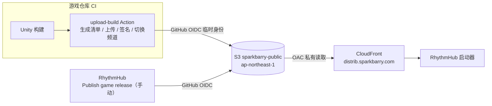

# RhythmHub 发布基础设施维护手册

本文记录 RhythmHub 的发布链路是怎么搭起来的、各种密钥和配置放在哪里、日常怎么发布与回滚，以及怎样接入新的游戏。
协议细节（清单格式、签名规则、本地目录）见 [update-protocol.md](update-protocol.md)。

> 2026-11-02 首次搭建。修改基础设施后请同步更新本文。

## 0. 速查（AI 助手先读这一节）

### 0.1 关键事实

| 项 | 值 |
|---|---|
| 发布根地址（CDN） | `https://distrib.sparkbarry.com/` |
| S3 桶 / 区域 | `sparkbarry-public` / `ap-northeast-1` |
| 对象布局 | `{gameId}/{platform}/{channel}.json`（频道指针）、`{gameId}/{platform}/{version}.json`（版本清单）、`{gameId}/{platform}/{version}/…`（平铺的游戏文件） |
| 已接入的 gameId | `MajdataPlay`、`OurTaikoPlay`、`OurTaikoEdit`（谱面编辑器，Avalonia）；测试专用 `PipelineTest` |
| platform 取值 | `Windows`、`MacOS` |
| 频道 | `stable`（`v*` 标签）、`nightly`（`main`，只留最新） |
| CI 角色 ARN | `arn:aws:iam::190779300206:role/rhythmhub-ci`（所有仓库的 Variable `AWS_ROLE_ARN`） |
| 签名 keyId | `rhythmhub-2026`（公钥在 `src/RhythmHub.Launcher/Services/ReleaseKeys.cs`） |
| 私钥文件 | 维护者本机 `~/.rhythmhub/rhythmhub-2026.key`；CI 中为 Secret `RHYTHMHUB_SIGNING_KEY` |
| 上传 Action | `sparkbarry/RhythmHub/.github/actions/upload-build@main` |
| 上线脚本 | `tools/ci/go-live.sh` |
| 发布工具 | `tools/RhythmHub.ReleaseTool`（`stage` / `publish` / `keygen` / `fake-game`） |
| 预编译发布工具 | GitHub Release `release-tool`（`rhythmhub-release-linux-x64.tar.gz`、`-osx-arm64.tar.gz`），由 `.github/workflows/release-tool.yml` 自动更新 |
| 手动发布 / 回滚工作流 | `.github/workflows/publish-game.yml`（Publish game release） |
| 回归测试工作流 | `.github/workflows/test-pipeline.yml`（Pipeline test，用 `PipelineTest/`） |
| AWS 权限模板 | `infra/aws/github-ci-roles.yaml`，CloudFormation 堆栈 `rhythmhub-ci`（东京） |

### 0.2 必须遵守的规则

1. **永远不要输出私钥内容**：不要 `cat`、`echo`、打印或粘贴 `~/.rhythmhub/*.key` 或 `RHYTHMHUB_SIGNING_KEY`。
   只用重定向把它交给工具，例如 `gh secret set RHYTHMHUB_SIGNING_KEY --repo <repo> < ~/.rhythmhub/rhythmhub-2026.key`，
   或 `RHYTHMHUB_SIGNING_KEY="$(cat …)" rhythmhub-release publish …`（命令本身不回显）。
2. **已发布的版本不可修改**：`{version}/` 和 `{version}.json` 一旦被频道指向过，就不能覆盖或改内容。要修复问题，请发一个新版本号。
3. **上线顺序固定**：游戏文件 → `{version}.json` → 确认 CDN 返回相同字节 → `{channel}.json` → 再次确认。切换频道指针就是让玩家看到新版本的那一步，必须放在最后。用 `tools/ci/go-live.sh` 完成，不要手写。
4. **缓存头**：频道指针用 `Cache-Control: no-cache`；版本清单和游戏文件用 `public, max-age=31536000, immutable`。不需要也不要做 CloudFront Invalidation。
5. **上传游戏目录必须带** `aws s3 sync --no-follow-symlinks`。符号链接、权限位和空目录记录在清单里，不作为 S3 对象上传。
6. **签名只通过** `rhythmhub-release publish` 完成。不要手工编辑已签名的 JSON，改任何一个字节都会让签名失效。
7. **OIDC 信任条件必须用带数字 ID 的 immutable subject**（见 §2.3），只写仓库名的格式会被 AWS 拒绝。
8. **桶里只放游戏发布文件**，桶的全部内容都会通过 CDN 公开。
9. **删除操作**只允许两种：`go-live.sh` 对 nightly 的自动清理，以及 Pipeline test 的 `cleanup`（只删 `PipelineTest/`）。不要手动删除其他游戏目录。
10. 修改上传 Action、`go-live.sh`、发布工具或 AWS 配置后，必须运行 **Pipeline test** 回归（§4.4），通过后再让真实游戏使用。
11. **自建机器磁盘有限**（MajdataPlay 的 Mac）：上传 Action 不能在 runner 上安装大的依赖。它使用预编译的发布工具，不需要 .NET SDK；准备构建目录时用 APFS 克隆（`cp -c`），不要整份复制。

### 0.3 当前进度（2026-11-02）

| 项 | 状态 |
|---|---|
| S3 + CloudFront + 域名 + 费用告警 | ✅ 完成 |
| CI 角色、各仓库 Variables / Secrets | ✅ 三个仓库都已配置（见 §3） |
| RhythmHub 手动发布、回归测试工作流 | ✅ 已用 PipelineTest 在真实环境验证 |
| OurTaikoPlay 自动发布 | ✅ 已合并（OurTaiko/OurTaikoPlay#49）。stable `1.0.0-400`（`v1.0.0` 标签）、nightly `1.0.0-404` 已上线；nightly 切 stable 实测复用 193 MB、只下载 87 MB。构建前会清理 runner 磁盘（#51） |
| MajdataPlay 自动发布 | ✅ 已合并（TeamMajdata/MajdataPlay#375、#376）。nightly `2.1.0-383a72b` 两个平台都已上线；Mac 版经更新核心从 CDN 安装验证通过（587 MB，codesign 有效）。还没打过 `v*`，所以暂无 stable |
| 游戏 Mac 版苹果签名 / 公证 | ⏳ 未做（通过启动器安装不受 Gatekeeper 隔离影响） |
| 启动器 Velopack 打包、自更新 | ✅ `v1.0.0` 已发布到 CDN 和 GitHub Release（见 §8）；CDN 与 GitHub 的 Mac 便携包一致，运行后自更新检查正常 |
| 启动器 macOS 签名公证 | ⏳ 等 RhythmHub 配好 §8.3 的 Apple Secrets；未配置时 Mac 包不签名 |
| 启动器 Windows 代码签名 | ⏳ 暂不做（安装时会有 SmartScreen 提示） |
| 启动器内切换 stable / nightly 频道 | ✅ v1.0.1 起每个游戏可单独选「稳定版 / 每日构建」，保存在 `{安装根目录}/settings.json`；默认取 `games.json` 的 `channel` |
| 自选游戏安装位置 | ✅ 每个游戏可选文件夹，保存在 `{安装根目录}/settings.json`；游戏直接从该文件夹运行，版本缓存在其 `.rhythmhub/`（见 update-protocol §6）。旧布局在启动时自动迁移。Windows 未实测 |
| Windows 真机安装测试 | ⏳ 未做 |
| OurTaikoEdit 自动发布 | ✅ 2026-11-11 接入（OurTaiko/OurTaikoEdit `build.yml`，CI 角色已信任该仓库）。stable（`v0.1.0` 标签）与 nightly 都是 `0.1.0-23`；启动器 `v1.0.5` 起列出它。暂无专用图标（启动器显示首字母）；Mac 包的 ad-hoc 签名在逐文件分发后不完整（.dll 的签名存在扩展属性里，会丢），能正常启动，但启用 `codesign --verify` 前要先解决 |

## 1. 总览



| 资源 | 值 |
|---|---|
| AWS 账号 | `190779300206` |
| S3 桶 | `sparkbarry-public`，东京 `ap-northeast-1`，阻止公共访问全开，默认加密 SSE-S3 |
| CloudFront 分配 | `E1MSZ7NK7FIW5X`，名称 `sparkbarry-public`，域名 `d1j38v8bnqdmma.cloudfront.net` |
| 自定义域名 | `distrib.sparkbarry.com`（证书由 ACM 在 us-east-1 签发，自动续期） |
| DNS | Cloudflare：`distrib` CNAME → `d1j38v8bnqdmma.cloudfront.net`，**仅 DNS（灰色云朵）** |
| CI 角色 | `arn:aws:iam::190779300206:role/rhythmhub-ci`，CloudFormation 堆栈 `rhythmhub-ci`（东京） |
| 清单签名密钥 | keyId `rhythmhub-2026`，Ed25519 |

⚠️ **桶里的所有内容都会通过 CDN 公开**，只放游戏发布文件。

## 2. AWS 配置

### 2.1 S3 + CloudFront

创建时的选择及原因：

- **源**选 S3 REST 端点 `sparkbarry-public.s3.ap-northeast-1.amazonaws.com`，不是 `s3-website` 端点；不开启桶的静态网站托管。
- **Allow private S3 bucket access to CloudFront** 勾选（OAC）。CloudFront 自动写入的桶策略只允许分配 `E1MSZ7NK7FIW5X` 执行 `s3:GetObject`。
  因为没有 `s3:ListBucket`，**不存在的文件返回 403**，启动器把 403 当作“不存在”处理。
- **缓存**用推荐的 `CachingOptimized`，它遵守对象自带的 `Cache-Control`：
  - 版本目录和 `{version}.json`：`public, max-age=31536000, immutable`
  - 频道指针 `stable.json` / `nightly.json`：`no-cache`
  所以**发布不需要做 Invalidation**。上传时由 Action 和脚本自动设置这些头，手动上传时也必须带上。
- 启动器不请求压缩传输（`AutomaticDecompression = None`），因为断点续传和按字节数核对都要求拿到原始字节。
- **不开 WAF**：静态只读文件用不到，而且会按请求数额外收费。
- **计费**：按量付费。曾考虑过包月 Free 方案（封顶但额度小），以后流量大了可以在分配详情页点 **Switch to a plan**。

### 2.2 费用告警

- **AWS Budgets**：月度成本预算 `$10`，实际花费达到 85% / 100% 时、以及预测会超支时，发邮件给维护者。
- **Cost Anomaly Detection**：监控 AWS services，单次异常超过 $5 时提醒。
- 预算只会提醒，不会自动停服。若遭恶意刷流量，可以在 CloudFront 分配页 **Disable** 临时停用。

### 2.3 CI 访问 AWS：GitHub OIDC + 角色

CI 不保存任何长期 AWS 密钥。每次运行时，GitHub 签发一次性身份令牌，AWS 验证后让工作流扮演 `rhythmhub-ci` 角色，拿到一小时有效的临时凭证。

- 角色由 [infra/aws/github-ci-roles.yaml](../infra/aws/github-ci-roles.yaml) 通过 CloudFormation 创建（堆栈 `rhythmhub-ci`，东京）。
- 权限：仅对 `sparkbarry-public` 桶有完整读写（`s3:*`），没有其他 AWS 权限。
- GitHub 身份提供商 `token.actions.githubusercontent.com` 在 OurTaikoView_Web 时已创建，部署参数 `CreateOidcProvider=false`。
- 信任的仓库，**必须使用带数字 ID 的 immutable subject**（这些组织都开启了这个设置，只写名字的旧格式会被拒绝）：

| 仓库 | Subject 前缀 |
|---|---|
| sparkbarry/RhythmHub | `repo:sparkbarry@118162831/RhythmHub@973319129` |
| TeamMajdata/MajdataPlay | `repo:TeamMajdata@210497401/MajdataPlay@763747540` |
| OurTaiko/OurTaikoPlay | `repo:OurTaiko@252237704/OurTaikoPlay@1400725485` |
| OurTaiko/OurTaikoEdit | `repo:OurTaiko@252237704/OurTaikoEdit@1446609117` |

查询某个仓库的前缀：

```bash
gh api repos/<owner>/<repo>/actions/oidc/customization/sub
```

仓库改名不会改变数字 ID，只需更新前缀里的名字；也可以把名字写成通配符（例如 `repo:sparkbarry@*/*@973319129`）。

## 3. Secrets 与 Variables

| 仓库 | 类型 | 名称 | 值 / 来源 | 用途 |
|---|---|---|---|---|
| sparkbarry/RhythmHub | Variable | `AWS_ROLE_ARN` | `arn:aws:iam::190779300206:role/rhythmhub-ci` | 发布工作流、测试工作流 |
| sparkbarry/RhythmHub | Secret | `RHYTHMHUB_SIGNING_KEY` | 清单签名私钥 | 手动发布、测试工作流 |
| sparkbarry/RhythmHub | Secret | `MACOS_CERTIFICATES_FILE_BASE64`、`MACOS_CERTIFICATES_PASSWORD` | Developer ID Application + Installer 证书（一个 .p12） | 启动器 Mac 版签名（§8.3） |
| sparkbarry/RhythmHub | Secret | `APPSTORE_KEY_ID`、`APPSTORE_ISSUER_ID`、`APPSTORE_PRIVATE_KEY` | App Store Connect API 密钥 | 启动器 Mac 版公证（§8.3） |
| OurTaiko/OurTaikoPlay | Variable | `AWS_ROLE_ARN` | 同上 | 上传构建 |
| OurTaiko/OurTaikoPlay | Secret | `RHYTHMHUB_SIGNING_KEY` | 清单签名私钥 | 自动签名上线 |
| OurTaiko/OurTaikoEdit | Variable | `AWS_ROLE_ARN` | 同上 | 上传构建 |
| OurTaiko/OurTaikoEdit | Secret | `RHYTHMHUB_SIGNING_KEY` | 清单签名私钥 | 自动签名上线 |
| TeamMajdata/MajdataPlay | Variable | `AWS_ROLE_ARN` | 同上 | 上传构建（CI 尚未接入） |
| TeamMajdata/MajdataPlay | Secret | `RHYTHMHUB_SIGNING_KEY` | 清单签名私钥 | 自动签名上线（CI 尚未接入） |

- `AWS_ROLE_ARN` 不是机密，放在 **Variables**，方便查看。
- 签名私钥放在 **Secrets**。GitHub 存进去之后就无法再读出来。
- 本仓库里还留着旧 Tauri 版的 `TAURI_SIGNING_*` 三个 Secret，RhythmHub 用不到，确认旧版不再发布后可以删除。

### 3.1 设置方法

在仓库的 **Settings → Secrets and variables → Actions** 页面操作，或者用 gh：

```bash
gh variable set AWS_ROLE_ARN --repo <owner>/<repo> --body "arn:aws:iam::190779300206:role/rhythmhub-ci"
```

```bash
gh secret set RHYTHMHUB_SIGNING_KEY --repo <owner>/<repo> < ~/.rhythmhub/rhythmhub-2026.key
```

第二条命令直接从文件读取私钥，内容不会显示在屏幕上。不要把私钥粘贴到命令行参数、聊天或 issue 里。

核对（只显示名称和更新时间，看不到值）：

```bash
gh secret list --repo <owner>/<repo>
```

```bash
gh variable get AWS_ROLE_ARN --repo <owner>/<repo>
```

### 3.2 清单签名密钥

- 用 `rhythmhub-release keygen --out ~/.rhythmhub/rhythmhub-2026.key` 生成，文件权限 `600`，所在目录权限 `700`。
- **公钥**写在启动器源码 [ReleaseKeys.cs](../src/RhythmHub.Launcher/Services/ReleaseKeys.cs) 里，keyId 为 `rhythmhub-2026`。
- **私钥**只存在三个地方：维护者本机的 `~/.rhythmhub/rhythmhub-2026.key`、维护者的密码管理器（备份）、上表中的 GitHub Secrets。
- `.gitignore` 已忽略 `*.key`。

**如果私钥丢失**（本机和备份都没了）：已安装的启动器将无法验证任何新发布的清单。只能生成新密钥，发布同时内置新公钥的启动器，等玩家更新启动器后再用新密钥签名。

**如果私钥泄露**：拿到私钥的人可以向玩家推送任意“游戏更新”，需要立即处理：

1. 生成新密钥对：`rhythmhub-release keygen --out ~/.rhythmhub/rhythmhub-<年份>.key`。
2. 在 `ReleaseKeys.cs` 里**删除**旧 keyId，加入新 keyId，并发布新启动器（启动器通过 Velopack 自更新）。
3. 更新所有仓库的 `RHYTHMHUB_SIGNING_KEY`，并把各工作流和 `upload-build` 的 `key-id` 默认值改成新 keyId。
4. 用新密钥重新发布各频道（对当前版本再跑一次发布即可重新签名指针；版本清单需重新签名上传）。

**正常轮换**（未泄露）：先发布同时信任新旧两把公钥的启动器，等它普及后改用新 keyId 签名，最后在之后的启动器版本里移除旧公钥。

## 4. 发布与回滚

### 4.1 频道

| 频道 | 来源 | 保留策略 |
|---|---|---|
| `stable` | 游戏仓库推送 `v*` 标签 | 永久保留 |
| `nightly` | 游戏仓库推送 `main` | 只保留最新一个；上线新 nightly 后，自动删除上一个 nightly，除非其他频道还指向它 |

目前启动器只读取 `games.json` 里的 `channel`（`stable`），还没有在界面上切换频道的功能，所以玩家暂时看不到 nightly。

### 4.2 自动发布（OurTaikoPlay、MajdataPlay、OurTaikoEdit）

| 仓库 | 工作流 | stable | nightly | 构建机器 |
|---|---|---|---|---|
| OurTaiko/OurTaikoPlay | `.github/workflows/build.yml` | `v*` 标签 | `main` | 全部在 GitHub 的 Ubuntu 机器上（GameCI） |
| OurTaiko/OurTaikoEdit | `.github/workflows/build.yml`（先跑测试 `ci.yml`） | `v*` 标签 | `main` | Windows 在 GitHub 的 Ubuntu 机器上（`dotnet publish -r win-x64` 交叉发布）；macOS 在 GitHub 的 `macos-latest`（Apple Silicon，`build/package.sh` 拼 `.app` 并 ad-hoc 签名） |
| TeamMajdata/MajdataPlay | `.github/workflows/main.yml` | `v*` 标签（只构建 Windows、macOS，跳过 Linux、Android、iOS 和 GitHub nightly Release） | `dev` | Windows 在 GitHub 的 Ubuntu 机器上；macOS 在**自建 Mac**（`majplay-apple`，和 `majplay-android`、`majplay-ios` 在同一台机器上） |

版本号：OurTaikoPlay 与 OurTaikoEdit 是 `版本-提交数`（例如 `1.0-400`；OurTaikoEdit 的版本写在 `Directory.Build.props` 的 `<Version>`）；MajdataPlay 是 `bundleVersion-提交号前7位`（例如 `2.1.0-6d68d84`）。

这些仓库都在 Windows / macOS 构建完成后调用
`sparkbarry/RhythmHub/.github/actions/upload-build@main`，依次执行：

0. 从 `release-tool` Release 下载预编译的 `rhythmhub-release`（没有对应平台的版本时，才回退到从源码构建，需要 .NET SDK），并在日志里打印 runner 的剩余磁盘空间。
1. `rhythmhub-release stage`：根据构建目录生成清单（文件哈希、权限位、符号链接、空目录）。
2. `aws s3 sync --no-follow-symlinks` 上传到 `{game}/{platform}/{version}/`。
3. 签名生成 `{version}.json`，上传后等 CDN 能拿到相同字节。
4. 上传频道指针 `{channel}.json`，这一步即为正式上线，之后再从 CDN 确认一次。
5. nightly 频道清理上一个版本（[tools/ci/go-live.sh](../tools/ci/go-live.sh)）。

版本号使用游戏 CI 的 `display` 版本，例如 `1.2.3-1450`（`版本-提交数`）。同一个版本号已经发布过时直接复用，不会覆盖。

### 4.3 手动发布 / 回滚（RhythmHub）

在 GitHub 打开 **sparkbarry/RhythmHub → Actions → Publish game release → Run workflow**，选择游戏、平台、版本、频道：

- 版本**已上传但未签名**：从 S3 拉下文件逐个核对哈希，签名后上线。
- 版本**已签名过**：只把频道指针重新指向它，这就是**服务端回滚**。注意 nightly 的旧版本会被自动清理，只能回滚到还在桶里的版本，`stable` 的历史版本都会保留。

也可以用命令行触发：

```bash
gh workflow run publish-game.yml --repo sparkbarry/RhythmHub -f game=OurTaikoPlay -f platform=Windows -f version=1.2.3-1450 -f channel=stable
```

客户端只要发现频道版本与已安装版本不同就会提示更新，所以指回旧版本时玩家也会被“更新”到旧版本。

### 4.4 发布链路回归测试

修改上传 Action、发布脚本或 AWS 配置后，在 RhythmHub 运行 **Actions → Pipeline test**：

1. `action=upload`，`channel` 选 `stable` 或 `nightly`。它会在 GitHub 的 macOS 机器上生成带 Framework、符号链接、中文文件名并做 ad-hoc 签名的假游戏，以及一个假的 Windows 版，然后走真实的上传和上线流程，发布到 `PipelineTest/` 下。
2. 需要时，用启动器代码从 `https://distrib.sparkbarry.com/PipelineTest/...` 安装验证。
3. 测完运行 `action=cleanup`，删除 `PipelineTest/`。

## 5. 接入新游戏

以接入一个名为 `NewGame`、仓库为 `SomeOrg/NewGame` 的 Unity 游戏为例。

### 5.1 确定标识

- **gameId**：就是 S3 顶层目录名，也是启动器本地目录名，区分大小写。只能用 ASCII 字母数字及 `.-_+`，例如 `NewGame`。
- **平台**：`Windows`（x64）或 `MacOS`（Apple Silicon）。
- **入口**：Windows 是构建根目录下的 `NewGame.exe`；macOS 是 `NewGame.app`。

### 5.2 AWS：让新仓库能扮演 CI 角色

1. 查 subject 前缀：

   ```bash
   gh api repos/SomeOrg/NewGame/actions/oidc/customization/sub
   ```

   如果返回 `"use_immutable_subject": false`，前缀是旧格式 `repo:SomeOrg/NewGame`。

2. 编辑 [infra/aws/github-ci-roles.yaml](../infra/aws/github-ci-roles.yaml)：在 `Parameters` 里加一个参数，并加进信任列表：

   ```yaml
   NewGameSubject:
     Type: String
     Default: repo:SomeOrg@<组织ID>/NewGame@<仓库ID>
   ```

   ```yaml
   token.actions.githubusercontent.com:sub:
     - !Sub ${PublisherSubject}:*
     - !Sub ${MajdataPlaySubject}:*
     - !Sub ${OurTaikoPlaySubject}:*
     - !Sub ${NewGameSubject}:*
   ```

3. 更新堆栈：AWS 控制台 → CloudFormation（东京）→ 选中 `rhythmhub-ci` → **Update stack** → **Make a direct update** →
   **Replace existing template** → 上传修改后的文件 → 确认 `CreateOidcProvider` 仍为 `false` → 一路 Next →
   勾选 IAM 确认 → **Submit**。等状态变为 `UPDATE_COMPLETE`。

角色 ARN 不会变，不需要改任何已有仓库的配置。

### 5.3 GitHub：给新仓库配置变量和密钥

```bash
gh variable set AWS_ROLE_ARN --repo SomeOrg/NewGame --body "arn:aws:iam::190779300206:role/rhythmhub-ci"
```

```bash
gh secret set RHYTHMHUB_SIGNING_KEY --repo SomeOrg/NewGame < ~/.rhythmhub/rhythmhub-2026.key
```

如果新游戏只想上传、由维护者在 RhythmHub 手动发布，则不需要第二条，签名私钥也就不会进入新仓库。

### 5.4 游戏 CI：构建后调用 upload-build

在构建 Windows / macOS 的 job 里：

1. 给 job 加权限：

   ```yaml
   permissions:
     contents: read
     id-token: write
   ```

2. Unity 构建完成后，把要发布的内容放到一个**只包含发布文件**的目录：Windows 是整个构建目录，去掉 `*_BurstDebugInformation_DoNotShip` 和 `*_BackUpThisFolder_ButDontShipItWithYourGame`；macOS 只放 `.app`。用 `cp -a` 复制，以保留符号链接和权限。

3. 调用 Action：

   ```yaml
   - uses: sparkbarry/RhythmHub/.github/actions/upload-build@main
     with:
       game: NewGame
       platform: Windows              # 或 MacOS
       version: ${{ needs.version.outputs.display }}   # 必须以数字开头，例如 1.2.3-1450
       build-path: ${{ runner.temp }}/rhythmhub
       entrypoint: NewGame.exe        # 或 NewGame.app
       role-arn: ${{ vars.AWS_ROLE_ARN }}
       channel: stable                # 留空 = 只上传，不上线
       signing-key: ${{ secrets.RHYTHMHUB_SIGNING_KEY }}
       prune-previous: false          # nightly 用 true
   ```

   可以直接参考 OurTaikoPlay `build.yml` 里的 **Prepare RhythmHub release** 和 **Publish to RhythmHub** 两个步骤，它们根据 `v*` 标签或 `main` 选择频道。

### 5.5 RhythmHub：启动器和手动发布

1. 在 [games.json](../src/RhythmHub.Launcher/games.json) 加一项：

   ```json
   {
     "id": "NewGame",
     "displayName": "NewGame",
     "description": { "en": "……", "zh": "……", "ja": "……" },
     "healthCheck": false
   }
   ```

   `description` 按界面语言取值，缺少当前语言时用 `en`。

   接入启动健康标记后（见下一步），把 `healthCheck` 改为 `true`。

2. 在 [publish-game.yml](../.github/workflows/publish-game.yml) 的 `game` 选项里加上 `NewGame`，手动发布和回滚时才能选到它。
3. 发布新版启动器，旧启动器的游戏列表里不会出现新游戏。

### 5.6 （推荐）启动健康标记

把 [docs/unity/RhythmHubHealth.cs](unity/RhythmHubHealth.cs) 放进游戏工程，在进入标题画面时调用 `RhythmHubHealth.ReportReady()`，然后把 `games.json` 里的 `healthCheck` 改为 `true`。
没有接入时，启动器只能把“进程活过 5 秒”当作启动成功。

### 5.7 首次发布后核对

```bash
curl -s https://distrib.sparkbarry.com/NewGame/Windows/stable.json
```

```bash
curl -sI https://distrib.sparkbarry.com/NewGame/Windows/stable.json | grep -i cache-control
```

应返回签名的指针 JSON，且带 `cache-control: no-cache`。然后在启动器里安装并启动一次。

## 6. 接入新平台

`Windows` 和 `MacOS` 之外的平台（例如 Windows ARM64、Intel Mac、Linux）不只是改配置：

1. 在 `RhythmHub.Platform` 里实现或扩展平台类，包括平台名、默认目录、启动方式、进程检测和包结构检查。
2. 平台名就是 S3 的目录名，要和游戏 CI 上传时的 `platform` 一致。
3. 启动器要为新平台打包发布（Velopack）。
4. 在 `publish-game.yml` 的 `platform` 选项里加上它。

## 7. 常见问题

### 7.1 事故记录：MajdataPlay 自建 Mac 磁盘耗尽（2026-11-02）

- **现象**：#375 合并后的第一次 `dev` 构建（run 41401868445）中，macOS 任务在 **Publish to RhythmHub** 这一步报 `No space left on device`，GitHub Runner 进程崩溃；同一台机器上的 Android 和 iOS 任务也一起失败。结果是这次推送没有上传 Google Play 和 TestFlight，也没有更新 GitHub nightly Release。Windows 的 RhythmHub nightly 正常上线。
- **原因**：这台 Mac 的磁盘本来就接近满了。当时的上传 Action 又在上面安装了 .NET SDK（约 1 GB），还用 `ditto` 把 `.app` 完整复制了一份，把磁盘撑满。
- **修复**：
  - 上传 Action 改为下载约 33 MB 的预编译工具，不再安装 SDK（RhythmHub `6624e82`）。
  - MajdataPlay 改用 `cp -cpR` 克隆 `.app`（TeamMajdata/MajdataPlay#376）。
  - 需要人工清理那台 Mac 的磁盘。如果 `~/.dotnet` 只是那次运行装上的，可以直接删除。
- **预防**：Action 现在会在日志里打印剩余空间。修改上传流程时遵守 §0.2 第 11 条。

### 7.2 报错速查

| 现象 | 原因与处理 |
|---|---|
| CI 报 `Not authorized to perform sts:AssumeRoleWithWebIdentity` | 仓库的 subject 不在信任列表里，或者用了不带数字 ID 的旧格式。**改仓库名或组织名也会改变 subject**（里面带名字），改名后要更新堆栈参数。用 `gh api …/oidc/customization/sub` 核对，再按 §5.2 更新堆栈。还要确认 job 有 `id-token: write` 权限 |
| CI 报 `already published. Bump the version` | 只上传模式（不带 `channel`）遇到了已发布过的版本号。已发布的版本不可覆盖，请换新版本号 |
| `publish` 报 `Uploaded files do not match the manifest` | 上传和发布之间文件被改动，或上传不完整。重新运行游戏 CI 的上传 |
| CDN 返回 403 | 文件不存在（桶策略只允许读取，不存在时统一返回 403）。核对路径大小写和空格编码 |
| 启动器提示“更新清单签名无效” | 签名用的私钥和启动器内置的公钥不配对，或者清单被改过。核对 `RHYTHMHUB_SIGNING_KEY` 和 `ReleaseKeys.cs` |
| 启动器提示“服务器上暂无该游戏的发布版本” | 对应频道的 `stable.json` 还不存在，比如还没打过 `v*` 标签 |
| 发布后玩家迟迟看不到新版本 | 检查 `{channel}.json` 的 `Cache-Control` 是否为 `no-cache`；手动上传时漏了这个头，CDN 最多会缓存 24 小时 |
| 自建机器报 `No space left on device` | 见 §7.1。先清理磁盘，然后在原运行上点 **Re-run failed jobs**，或者再推一次触发构建 |
| 日志出现 `No prebuilt rhythmhub-release for …` | runner 的平台（例如 Intel Mac、Linux ARM）没有预编译版本，会自动回退到安装 .NET SDK 并从源码构建。需要的话，在 `release-tool.yml` 的 matrix 里加上这个平台 |

## 8. 启动器发布（`Launcher` 工作流）

启动器用 [Velopack](https://docs.velopack.io) 打包和自更新，和游戏的发布协议无关：不用清单签名私钥，
文件格式由 Velopack 决定。

### 8.1 触发方式

| 触发 | 做什么 |
|---|---|
| 推送到 `main` / `rhythmhub`、PR、手动运行 | Windows 和 macOS 上 `dotnet test`，再用 `vpk pack` 打包（版本号 `0.0.1-ci.<运行号>`），产物只作为 Artifact，不发布 |
| 推送 `v*` 标签（如 `v1.0.0`，必须 ≥ 1.0.0） | 同上，用标签里的版本号；再上传到 CDN 并创建 GitHub Release。带 `-` 的版本（如 `1.0.0-rc.1`）标成 Pre-release |

```bash
git tag v1.0.0 && git push origin v1.0.0
```

`v0.x` 标签和 Release 属于旧 Tauri 版 MajdataHub，工作流遇到 `v0.*` 标签会直接报错。RhythmHub 从 `v1.0.0` 开始。

### 8.2 发布位置

| 位置 | 内容 |
|---|---|
| `https://distrib.sparkbarry.com/RhythmHub/Windows/` | `releases.win.json`（自更新源）、`RhythmHub-<v>-full.nupkg` / `-delta.nupkg`、`RhythmHub-win-Setup.exe`、`RhythmHub-win-Portable.zip` |
| `https://distrib.sparkbarry.com/RhythmHub/MacOS/` | `releases.osx.json`、`RhythmHub-<v>-osx-full.nupkg` / `-delta.nupkg`、`RhythmHub-osx-Setup.pkg`、`RhythmHub-osx-Portable.zip` |
| GitHub Release `v<v>` | 沿用旧 MajdataHub 的格式：标题 `RhythmHub v<v>`、无说明；`RhythmHub_<v>_x64-setup.exe`、`RhythmHub_<v>_x64-portable.zip`、`RhythmHub_<v>_aarch64.pkg`、`RhythmHub_<v>_aarch64-portable.zip`，外加本版本的 nupkg 和 `releases.*.json`（可作备用更新源） |

- 安装包下载地址固定：`…/RhythmHub/Windows/RhythmHub-win-Setup.exe`、`…/RhythmHub/MacOS/RhythmHub-osx-Setup.pkg`，总是最新版。
- 启动器启动后在后台检查 `RhythmHub/<平台>/`，有新版就下载，底部出现「重启更新」。不点的话，下次启动时自动应用。
  只有通过安装包或便携包安装的启动器会自更新，`dotnet run` 不会。
- 上传由 `tools/ci/launcher-upload.sh` 完成，顺序是 nupkg → 安装包等 → 最后 `releases.*.json`。
  nupkg 是 `immutable`，已存在的同版本 nupkg 会让发布失败（版本号不能重用）；其余文件名固定，用 `no-cache`。
- 打包前先从 CDN 下载上一版，用来生成 delta 包（几十 KB 到几 MB）。

### 8.3 macOS 签名和公证（需要配置一次）

不配置时 Mac 包照样生成，但没有签名。用户下载后 Gatekeeper 会拦截，需要在「系统设置 → 隐私与安全性」里手动允许。
配置步骤：

1. 在 [Apple Developer → Certificates](https://developer.apple.com/account/resources/certificates/list) 创建
   **Developer ID Application** 和 **Developer ID Installer** 两个证书（需要账号持有者权限），下载后双击导入本机钥匙串。
2. 在「钥匙串访问」里同时选中这两个证书（连同私钥），导出成一个 `.p12` 并设密码。
3. 上传（.p12 用 base64，密码从提示输入，不进命令历史）：

   ```bash
   base64 -i DeveloperID.p12 | gh secret set MACOS_CERTIFICATES_FILE_BASE64 --repo sparkbarry/RhythmHub
   gh secret set MACOS_CERTIFICATES_PASSWORD --repo sparkbarry/RhythmHub
   ```

4. 公证用 App Store Connect API 密钥（[Users and Access → Integrations](https://appstoreconnect.apple.com/access/integrations/api)，
   角色 Developer 即可）。可以和 OurTaikoPlay 的 TestFlight 用同一把，名称也一样：

   ```bash
   gh secret set APPSTORE_KEY_ID --repo sparkbarry/RhythmHub
   gh secret set APPSTORE_ISSUER_ID --repo sparkbarry/RhythmHub
   gh secret set APPSTORE_PRIVATE_KEY --repo sparkbarry/RhythmHub < AuthKey_XXXXXXXXXX.p8
   ```

工作流会建一个临时钥匙串，按名字前缀找出两个 Developer ID 身份，`vpk pack` 用它们签名 `.app` 和 `.pkg` 并提交公证，结束后删除钥匙串。
.NET 需要的 Hardened Runtime 权限在 `build/macos/RhythmHub.entitlements`。

### 8.4 注意

- 启动器的 `games.json` 是打包进去的。改了游戏目录（例如接入新游戏）要发一个新的启动器版本。
- 启动器版本号就是程序集版本，游戏的 `min-launcher-version` 和它比较。
- 回滚启动器：Velopack 不支持把已安装的启动器降级。发一个修复版本（版本号更高）即可。
- 还没有图标：目前用 Velopack 和系统的默认图标。
- 旧 Tauri 版客户端（v0.5.x）的更新地址是 GitHub `releases/latest/download/latest.json` 和 CNB 镜像。
  `v1.x` 成为 Latest 后，前者返回 404，旧客户端只会认为没有更新，不会装上 RhythmHub。旧用户需要手动下载新安装包。

