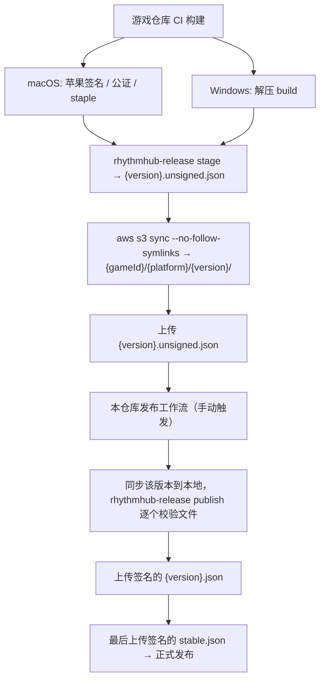

# RhythmHub 更新协议（v2）

本文档定义 RhythmHub 启动器、游戏仓库 CI、本仓库发布工作流与静态更新源（S3 + CloudFront）之间的约定。

v2 与计划书的主要差异：

- **游戏文件按版本平铺存放**，不打 zip。这样既能按版本追溯，也能做文件级增量更新：只下载与已安装版本不同的文件。
- 所有路径都按 `gameId` 区分，支持多游戏。

## 1. 标识符

| 名称 | 示例 | 规则 |
|---|---|---|
| `gameId` | `MajdataPlay`、`OurTaikoPlay` | ASCII 字母数字及 `.-_+`；就是 S3 上的顶层目录名，区分大小写 |
| `platform` | `Windows`、`MacOS` | `Windows` = x64；`MacOS` = Apple Silicon（不支持 Intel Mac） |
| `channel` | `stable` | 首版仅 `stable` |
| `version` | `1.2.0`、`1.2.0-beta.1` | 必须以数字开头（避免与 `stable.json` 等频道文件重名），≤ 64 字符 |

客户端会拒绝任何不合规的标识符（它们来自网络，会被拼进本地路径和 URL）。

## 2. S3 目录

```text
{feedBase}/                                   # https://distrib.sparkbarry.com/
└── {gameId}/
    └── {platform}/
        ├── stable.json                       # 频道指针（签名）  Cache-Control: no-cache
        ├── {version}.json                    # 版本清单（签名）  immutable
        ├── {version}.unsigned.json           # 游戏 CI 上传的未签名清单，仅供发布工作流使用
        └── {version}/                        # 游戏 build 原样平铺    immutable
            ├── MajdataPlay.exe …             # Windows：build 压缩包里的内容
            └── MajdataPlay.app/…             # macOS：签名、公证后的 .app
```

- URL 中每一段路径都做百分号编码（空格、`+`、中文等都安全）。清单里只有相对路径，**不含域名**，换 CDN 域名不需要重新签名。
- `{version}/` 与 `{version}.json` 发布后**永不修改**：`Cache-Control: public, max-age=31536000, immutable`。
- `stable.json` 必须设为 `no-cache`（或很短的 max-age），客户端请求时也带 `Cache-Control: no-cache`。
- S3 本身不支持自定义域名 HTTPS，前面需要 CloudFront。CloudFront 需支持 Range 请求（默认支持）。
- 缺失的对象在私有桶上会返回 403，客户端按“不存在”处理。

## 3. 频道指针 `stable.json`

```json
{
  "schemaVersion": 2,
  "gameId": "MajdataPlay",
  "platform": "MacOS",
  "channel": "stable",
  "version": "1.2.0",
  "manifestSha256": "<{version}.json 文件字节的 SHA-256，64 位小写 hex>",
  "signature": { "algorithm": "Ed25519", "keyId": "release-2026", "value": "<base64>" }
}
```

替换它就是**发布**；把它指回一个旧版本就是**服务端回滚**。客户端只要发现指针版本或 `manifestSha256` 与本地已安装版本不同，就视为有可用版本，因此指向旧版本也会被当作一次“更新”。

## 4. 版本清单 `{version}.json`

```json
{
  "schemaVersion": 2,
  "gameId": "MajdataPlay",
  "platform": "MacOS",
  "version": "1.2.0",
  "entrypoint": "MajdataPlay.app",
  "minimumLauncherVersion": "0.1.0",
  "releaseNotesUrl": "https://…/1.2.0.md",
  "files": [
    { "path": "MajdataPlay.app/Contents/MacOS/MajdataPlay", "size": 123456, "sha256": "…", "mode": 493 },
    { "path": "MajdataPlay.app/Contents/Info.plist", "size": 1024, "sha256": "…", "mode": 420 }
  ],
  "symlinks": [
    { "path": "MajdataPlay.app/Contents/Frameworks/X.framework/Versions/Current", "target": "A" }
  ],
  "directories": [ "MajdataPlay.app/Contents/PlugIns" ],
  "signature": { … }
}
```

- `files[].path` 同时也是对象键 `{gameId}/{platform}/{version}/{path}` 的后缀。
- `mode` 是 Unix 权限位（0–0o777，不允许 setuid/setgid）。Windows build 不带此字段。
- **符号链接、权限位、空目录无法存成 S3 对象**，所以记录在清单里，由客户端重建。上传时必须用
  `aws s3 sync --no-follow-symlinks`，否则符号链接指向的内容会被重复上传（客户端会忽略这些多余对象，但浪费空间）。
- `directories` 只列没有任何子项的空目录，其余目录由文件路径隐含。

客户端校验（`ManifestClient`）：

1. 指针：签名有效；`gameId`、`platform`、`channel` 与请求一致。
2. 清单：文件字节的 SHA-256 必须等于指针里的 `manifestSha256`，签名有效，`version` 与指针一致。
3. 路径：相对路径、`/` 分隔，不含 `..`、`.`、空段、`\`、`:`、控制字符、`<>"|?*`，段末不能是空格或 `.`，
   不能是 Windows 保留名（`CON`、`AUX`、`COM1` 等），不能位于 `.rhythmhub/` 下。
   所有路径（不区分大小写）不得重复；任何条目不得位于符号链接之下；符号链接目标必须是相对路径，且不能指出版本根目录。
4. `entrypoint` 必须是顶层文件（Windows `.exe`）或顶层 bundle（macOS `.app`），且确实在 `files` 中。
5. `minimumLauncherVersion` 高于当前启动器版本时报 `LauncherTooOld`，不下载任何文件。

### 签名

| 项 | 规定 |
|---|---|
| 算法 | Ed25519（RFC 8032），`signature.algorithm` 必须为 `"Ed25519"` |
| 签名内容 | 收到的 JSON 去掉顶层 `signature` 成员后，按 RFC 8785 (JCS) 规范化得到的 UTF-8 字节 |
| 数字 | 只允许 ±2^53 以内的整数；出现小数、指数或超范围整数时拒绝（避免 JCS 数字格式化分歧） |
| 编码 | `signature.value` 为 64 字节签名的标准 base64；公钥为 32 字节原始公钥的 base64 |
| 信任 | 客户端只信任编译进启动器的 `keyId → 公钥` 表（`ReleaseKeys.cs`）；清单里不携带公钥，未知 `keyId` 直接拒绝 |
| 校验对象 | 对**收到的原始字节**解析后校验，而不是对反序列化后的模型重新序列化，因此任何多余字段也受签名保护 |

私钥只存放在本仓库的 CI Secret（`RHYTHMHUB_SIGNING_KEY`），游戏仓库不持有私钥。

密钥轮换：生成新密钥对 → 新启动器版本同时内置新旧公钥 → 等该版本普及后改用新 `keyId` 签名 →
确认没有在用的清单仍使用旧 `keyId` 后，在之后的启动器版本中移除旧公钥。

Debug 构建可以用环境变量 `RHYTHMHUB_DEV_PUBLIC_KEY=keyId=base64公钥` 额外信任一把本地测试密钥；Release 构建不读取该变量。

## 5. 发布流程



1. **游戏 CI**（MajdataPlay、OurTaikoPlay 各自的仓库）：
   - 构建；macOS 版完成签名、公证、staple **之后**再进入下一步。
   - `rhythmhub-release stage --game MajdataPlay --platform MacOS --version 1.2.0 --input <build 目录> --entrypoint MajdataPlay.app --out 1.2.0.unsigned.json`
     （`--input` 是直接包含 `.exe` 或 `.app` 的目录。）
   - `aws s3 sync <build 目录> s3://<bucket>/MajdataPlay/MacOS/1.2.0/ --no-follow-symlinks --cache-control "public, max-age=31536000, immutable"`
   - `aws s3 cp 1.2.0.unsigned.json s3://<bucket>/MajdataPlay/MacOS/1.2.0.unsigned.json`
2. **本仓库发布工作流**：
   - `aws s3 sync s3://<bucket>/MajdataPlay/MacOS/1.2.0/ feed/MajdataPlay/MacOS/1.2.0/`，并下载 `1.2.0.unsigned.json`。
   - `rhythmhub-release publish --feed feed --game MajdataPlay --platform MacOS --version 1.2.0 --key-id release-2026`：
     逐个核对已上传文件的大小与 SHA-256，不一致则中止；然后生成签名的 `1.2.0.json` 和 `stable.json`。
   - 先上传 `1.2.0.json`（immutable），确认可访问后再上传 `stable.json`（no-cache）。
3. **服务端回滚**：对已发布过的版本再跑一次 `publish`。工具发现 `{version}.json` 已签名，就只重新生成 `stable.json` 指向它。

## 6. 本地目录

```text
{installRoot}/                        # macOS: ~/Library/Application Support/RhythmHub
├── launcher.lock                     # 单实例锁；Windows: %LOCALAPPDATA%\RhythmHub
├── settings.json                     # 语言、各游戏频道与游戏文件夹
├── logs/launcher-YYYYMMDD.log
└── games/{gameId}/                   # 没选过位置的游戏文件夹默认在这里

{游戏文件夹}/                          # 玩家选的文件夹；游戏就从这里运行
├── MajdataPlay.app | MajdataPlay.exe …  # 当前版本，按清单布置
├── settings.json, 谱面 …              # 游戏自己写的文件，启动器不碰，跨版本保留
└── .rhythmhub/                       # Windows 上设为隐藏
    ├── versions/
    │   └── {version}/                # 当前版本和回滚目标的原样副本
    │       ├── MajdataPlay.app | MajdataPlay.exe …
    │       └── .rhythmhub/
    │           ├── manifest.json     # 安装时的签名清单原文，用于下次增量比对
    │           └── release.json
    ├── downloads/{version}/          # 内容寻址：{sha256} 已校验对象，{sha256}.partial 下载中
    ├── staging/{uuid}/
    ├── health/health.json            # 游戏写入的启动健康标记
    ├── current.json
    ├── pending.json
    └── deployed.json                 # 游戏文件夹里布置的是哪个版本、启动器放过哪些路径
```

清单路径不能以 `.rhythmhub/` 开头（§4），所以游戏文件不会和它冲突。
游戏（MajdataPlay、OurTaikoPlay）把设置、谱面、成绩写在可执行文件旁边（macOS 上在 `.app/Contents` 里），
因此游戏文件夹固定后，这些文件在更新和回滚后都还在。

### 更新过程

1. **检查**：读指针 → 读清单 → 校验。用当前版本和回滚目标版本的 `manifest.json` 估算需要下载的字节数。
2. **准备对象**（`downloads/{version}/`，每个不同的 SHA-256 存一份）：
   - 已安装版本中有相同哈希的文件：复制过来（APFS 上是写时复制克隆，几乎不占空间），**重新计算哈希**，
     匹配才采用；本地文件损坏则改为下载。
   - 其余文件并行下载（默认 6 路，大文件优先），完成后校验 SHA-256，匹配才改名为正式对象。
3. **组装**：在 `staging/{uuid}` 中按清单建目录、放文件（只用一次的对象直接移动，多次使用的复制）、
   设置权限位，最后创建符号链接（保证不会有文件经由符号链接写出）。
4. **检查**：入口存在，平台结构检查通过，写入 `.rhythmhub/`。
5. **提交**：移动到 `versions/{version}` → 原子替换 `current.json`（提交点）→ 布置到游戏文件夹（见下）→
   删除 `downloads/{version}`、清理旧版本。回滚同样是先改 `current.json`，再布置回滚目标。

### 布置到游戏文件夹

`deployed.json` 记录 `{ version, complete, paths }`，`paths` 是启动器可能放进游戏文件夹的全部路径（文件、链接、目录）。

1. 先写 `complete: false`，`paths` = 旧记录 ∪ 新清单。
2. 删除旧记录里有、新清单里没有的路径（由深到浅；目录只在空时删除；经由链接的路径不碰）。
3. 按新清单建目录、放文件、建符号链接。文件从 `versions/{version}` 复制（APFS 上是克隆，不占额外空间），
   保留修改时间：大小和修改时间都与缓存相同的文件跳过。
4. 写 `complete: true`，`paths` = 新清单。

清单之外的路径一律不碰。中断后 `complete` 为 `false` 或 `version` 不是 `activeVersion`，
下次恢复或启动游戏前会重新布置（幂等）。游戏运行时不布置，报 `GameRunning`。
磁盘检查额外计入新版本比当前布置版本多出的大小。

### 更换游戏文件夹

- 选中的文件夹为空、不存在、以游戏 id 命名、已是该游戏的 RhythmHub 文件夹，或含 `{id}.exe` / `{id}.app` / `{id}_Data`
  （单独安装的旧版）时直接使用；否则在其中建 `{id}` 子文件夹。卷根目录、当前文件夹的子目录、与其他游戏文件夹互相嵌套的都拒绝。
- 目标已是该游戏的 RhythmHub 文件夹：直接改用它。否则若当前文件夹有 `.rhythmhub/`，把整个文件夹（游戏、存档、缓存）
  移过去：同卷改名，跨卷复制后删除原文件夹；目标必须为空。
- 位置保存在 `settings.json` 的 `gameDirectories`。

### 下载与续传

- 版本路径不可变、每个对象下载后都校验哈希，因此续传直接用 `Range: bytes=N-`，不需要 ETag。
  续传后哈希不对时，丢弃并完整重下一次；第二次仍不对则报 `HashMismatch`，说明服务器上的文件本身有问题。
- 网络错误、超时（30 秒无数据）、429/503 自动重试，最多 4 次，指数退避（尊重 `Retry-After`）；404/403/410 不重试。

### 状态文件

`current.json`：

```json
{
  "schemaVersion": 1,
  "activeVersion": "1.1.0",
  "previousGoodVersion": "1.0.0",
  "channel": "stable",
  "lastLaunchSuccessful": true
}
```

- 写入方式：同目录临时文件 → flush 到磁盘 → rename 覆盖。替换 `current.json` 即为安装提交点。
- 始终保留 `activeVersion` 与 `previousGoodVersion`，其余版本在安装后清理。
- `previousGoodVersion` 只会是**成功启动过**的版本：安装新版时，若当前版本从未通过启动健康检查，则保留原来的
  `previousGoodVersion` 作为回滚目标（首个安装的版本例外）。回滚后被放弃的版本不再作为回滚目标。
- 游戏写在游戏文件夹里的文件（不在清单中）和 Unity `Application.persistentDataPath` 下的数据，启动器都不碰。

`pending.json` 记录进行中的更新，**从不作为已安装的依据**：

```json
{ "schemaVersion": 2, "version": "1.2.0", "manifestSha256": "…", "stage": "Downloading | Downloaded | Installing", "updatedAt": "…" }
```

启动时恢复（`GameUpdateService.RecoverAsync`），在持有单实例锁后执行：

| 情况 | 处理 |
|---|---|
| `Installing` 且 `current.json` 已指向该版本 | 提交已完成，只差清理：删除 `pending.json` |
| `Installing` 但未提交 | 组装时部分对象已被移走 → 回到 `Downloading`，下次只补齐缺的对象 |
| `downloads/{version}/` 已不存在 | 删除 `pending.json` |
| 其余 | 保留，下次继续 |

之后清空 `staging/`，删除 `current.json` 未引用的版本目录，以及 `downloads/` 中 `pending.json` 未记录的内容，
最后补完未完成的布置。

**旧布局迁移**：v1.0.3 及更早把 `versions/`、`downloads/`、`current.json` 等直接放在 `games/{gameId}/` 下，
游戏从 `versions/{version}` 里运行。恢复时若发现这种布局（游戏未运行时），把它们移进 `.rhythmhub/`，
并把当前版本目录中清单以外的文件（游戏保存的设置、谱面）移到游戏文件夹的相同位置，然后布置当前版本。
`current.json` 最后移动，中断后可重跑。
频道指向别的版本或清单变了时，旧的下载会被丢弃。

## 7. 启动健康检查

启动游戏时，启动器生成一次性 nonce，并通过环境变量传给游戏进程（macOS 用 `open -n --env`）：

| 变量 | 内容 |
|---|---|
| `RHYTHMHUB_HEALTH_FILE` | 健康标记文件的绝对路径 |
| `RHYTHMHUB_LAUNCH_NONCE` | 本次启动的 32 位 hex nonce |
| `RHYTHMHUB_GAME_VERSION` | 启动器认为正在启动的版本号 |

游戏完成初始化（例如进入标题画面）后，写临时文件再 rename 到 `RHYTHMHUB_HEALTH_FILE`：

```json
{ "nonce": "<RHYTHMHUB_LAUNCH_NONCE>", "version": "<RHYTHMHUB_GAME_VERSION>" }
```

可直接使用 [`docs/unity/RhythmHubHealth.cs`](unity/RhythmHubHealth.cs)，在合适时机调用 `RhythmHubHealth.ReportReady()`。

启动器判定：

| 结果 | 条件 | 处理 |
|---|---|---|
| Healthy | 读到 nonce 和版本都匹配的标记 | `lastLaunchSuccessful = true`，该版本此后可作为回滚目标 |
| Exited | 未报告就绪而进程已消失（5 秒启动宽限期后） | `lastLaunchSuccessful = false`，界面提示可“恢复上一版本” |
| TimedOut | 2 分钟内仍在运行但没有标记 | 保持原状态，提示用户若异常可回滚 |

尚未接入标记的游戏在 `games.json` 中设 `"healthCheck": false`：进程活过宽限期即视为 Healthy（较弱的判定）。
接入后改为 `true`。启动器不会自动回滚，只提示，由用户决定。

## 8. 本地开发

| 环境变量 | 作用 |
|---|---|
| `RHYTHMHUB_FEED_URL` | 覆盖 `games.json` 里的 `feedBaseUrl`，例如 `http://127.0.0.1:8787/` |
| `RHYTHMHUB_INSTALL_ROOT` | 把设置、日志和默认游戏文件夹放到别处，不影响真实安装（自选的游戏文件夹记在该根目录的 `settings.json` 里） |
| `RHYTHMHUB_DEV_PUBLIC_KEY` | 仅 Debug 构建：`keyId=base64公钥`，额外信任的本地测试签名公钥 |
| `RHYTHMHUB_SIGNING_KEY` | 发布工具使用的 base64 私钥（只放在本机测试或 CI Secret 中） |
